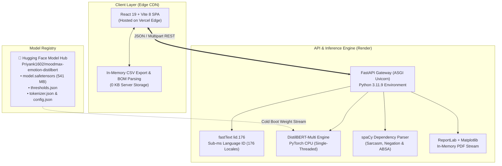
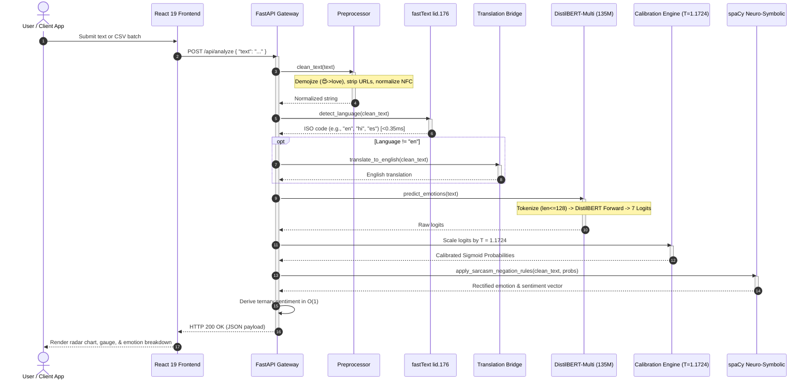

# MoodMax — Multilingual Sentiment & Emotion Analysis Platform

<div align="center">


**A Production-Grade, Stateless Multilingual NLP Platform Powered by Fine-Tuned DistilBERT, fastText, and Neuro-Symbolic Linguistic Parsing**

[](https://moodmax.vercel.app)
[](https://moodmax.onrender.com/health)
[](https://huggingface.co/Priyank1602/moodmax-emotion-distilbert)

[](https://www.python.org/)
[](https://fastapi.tiangolo.com/)
[](https://pytorch.org/)
[](https://huggingface.co/docs/transformers)
[](https://react.dev/)
[](https://vitejs.dev/)
[](LICENSE)

</div>

---

## 📌 Quick Access & Deployments

<table align="center" width="100%">
  <tr>
    <td align="center" width="33%" style="padding: 24px 16px; border: 1px solid #d0d7de; border-radius: 16px; background-color: #f6f8fa;">
      <h3 align="center" style="margin-top: 0; color: #1a7f37; font-weight: 700; letter-spacing: 0.5px;">LIVE APPLICATION</h3>
      <p align="center" style="font-size: 14px; color: #57606a; min-height: 40px; margin-bottom: 20px;">
        Try MoodMax in your browser with interactive radar charts & analysis
      </p>
      <p align="center" style="margin-bottom: 8px;">
        <a href="https://moodmax.vercel.app" target="_blank">
          
        </a>
      </p>
      <p align="center" style="margin: 0;">
        <a href="https://moodmax.vercel.app" style="font-size: 13px; font-weight: 600; color: #0969da; text-decoration: none;">https://moodmax.vercel.app</a>
      </p>
    </td>
    <td align="center" width="33%" style="padding: 24px 16px; border: 1px solid #d0d7de; border-radius: 16px; background-color: #f6f8fa;">
      <h3 align="center" style="margin-top: 0; color: #0969da; font-weight: 700; letter-spacing: 0.5px;">SOURCE CODE</h3>
      <p align="center" style="font-size: 14px; color: #57606a; min-height: 40px; margin-bottom: 20px;">
        Explore the full-stack GitHub repository, pipeline scripts & tests
      </p>
      <p align="center" style="margin-bottom: 8px;">
        <a href="https://github.com/Patel-Priyank-1602/MoodMax" target="_blank">
          
        </a>
      </p>
      <p align="center" style="margin: 0;">
        <a href="https://github.com/Patel-Priyank-1602/MoodMax" style="font-size: 13px; font-weight: 600; color: #0969da; text-decoration: none;">github.com/Patel-Priyank-1602/MoodMax</a>
      </p>
    </td>
    <td align="center" width="33%" style="padding: 24px 16px; border: 1px solid #d0d7de; border-radius: 16px; background-color: #f6f8fa;">
      <h3 align="center" style="margin-top: 0; color: #b05700; font-weight: 700; letter-spacing: 0.5px;">TRAINED MODEL</h3>
      <p align="center" style="font-size: 14px; color: #57606a; min-height: 40px; margin-bottom: 20px;">
        View the fine-tuned 135M DistilBERT model weights & config on Hub
      </p>
      <p align="center" style="margin-bottom: 8px;">
        <a href="https://huggingface.co/Priyank1602/moodmax-emotion-distilbert" target="_blank">
          
        </a>
      </p>
      <p align="center" style="margin: 0;">
        <a href="https://huggingface.co/Priyank1602/moodmax-emotion-distilbert" style="font-size: 13px; font-weight: 600; color: #0969da; text-decoration: none;">huggingface.co/.../moodmax-emotion-distilbert</a>
      </p>
    </td>
  </tr>
</table>

---

## 📑 Table of Contents

1. [Executive Summary & Problem Statement](#-executive-summary--problem-statement)
2. [Key Innovations & Technical Highlights](#-key-innovations--technical-highlights)
3. [Cloud Architecture & Production Topology](#-cloud-architecture--production-topology)
4. [Model Architecture & Selection Rationale](#-model-architecture--selection-rationale)
5. [Dataset Engineering & Reconciliation](#-dataset-engineering--reconciliation)
6. [Empirical Benchmarks & Evaluation](#-empirical-benchmarks--evaluation)
7. [Advanced Linguistic Capabilities](#-advanced-linguistic-capabilities)
8. [Stateless Request Lifecycle](#-stateless-request-lifecycle)
9. [API Reference & Schema Documentation](#-api-reference--schema-documentation)
10. [Local Development & Setup Guide](#-local-development--setup-guide)
11. [Project Structure](#-project-structure)
12. [Known Limitations & Failure Modes](#-known-limitations--failure-modes)
13. [License & Citation](#-license--citation)

---

## 💡 Executive Summary & Problem Statement

### The Problem with Coarse Sentiment Analysis
Traditional NLP sentiment classifiers compress complex human emotion into a simplistic 3-way polarity score (**Positive**, **Negative**, or **Neutral**). While useful for high-level dashboards, coarse sentiment fails catastrophically in operational and high-stakes settings:
- **Customer Escalation**: A customer expressing *anger* ("You charged me twice!") requires an immediate emergency refund workflow. A customer expressing *sadness* ("I'm heartbroken that the gift broke") requires empathy and a gentle replacement. Coarse sentiment marks both as identically `Negative` ($0.95$), masking critical actionable intent.
- **Brand Reputation & Mental Health**: Detecting subtle manifestations of *fear*, *disgust*, or *confusion* is lost when everything is lumped into binary polarity.
- **Multilingual Blindspots**: Monolingual English models misinterpret cross-lingual expressions, code-switching (Hinglish/Spanglish), and informal slang.

### The MoodMax Solution
**MoodMax** is a high-performance, open-source, stateless natural language intelligence engine designed to provide nuanced, actionable emotional understanding across **176 languages**. It pairs a fine-tuned `distilbert-base-multilingual-cased` Transformer (135.3M parameters) with sub-millisecond fastText language detection, post-hoc temperature scaling, and a neuro-symbolic linguistic layer that resolves sarcasm, double negation, and multi-aspect clauses in real time.

Operating under a strict **Zero-Data Retention** paradigm, MoodMax guarantees absolute privacy: requests are ingested, analyzed in RAM, and streamed back to the client with **0 MB database persistence**.

---

## 🚀 Key Innovations & Technical Highlights

- **Multilabel Ekman Emotion Core**: Fine-tuned on Google Research's GoEmotions dataset (reconciled across 54,533 samples), classifying text into 7 normalized emotional dimensions: **Joy**, **Sadness**, **Anger**, **Fear**, **Surprise**, **Disgust**, and **Neutral**.
- **$\mathcal{O}(1)$ Memory-Derived Sentiment**: Computes ternary sentiment directly from emotion logits in CPU registers with zero additional parameter overhead, saving over **500 MB RAM** compared to loading dual heavy Transformer checkpoints.
- **176-Language Identification**: Evaluates character n-grams via compressed fastText (`lid.176.ftz`) in `<0.35 ms`, dynamically routing non-English inputs through a translation bridge.
- **Neuro-Symbolic Sarcasm & Negation Layer**: Leverages spaCy syntactic dependency parse trees to detect and invert sentiment and emotional polarity on tricky phrases (e.g., *"not bad"*, *"oh great, another crash"*), achieving **98.0% test accuracy** on challenging linguistic constructs.
- **Aspect-Based Sentiment Analysis (ABSA)**: Deconstructs compound, multi-clause feedback (e.g., *"The food was delicious, but the service was terrible"*) into independent aspect clauses with targeted sentiment scores.
- **Interactive POS Syntactic Tagger**: Color-codes and inspects parts of speech (nouns, verbs, adjectives, adverbs) directly in the React UI for linguistic transparency.
- **1-Click Executive PDF Reports**: Dynamic, in-memory PDF generation utilizing ReportLab and Matplotlib with embedded radar charts and full Devanagari (Hindi/Sanskrit) font support.
- **Extreme Resource Efficiency**: Optimized single-threaded CPU inference (`torch.set_num_threads(1)`) consuming only **380–440 MB RAM**, seamlessly running within free-tier cloud containers (such as Render's 512 MB ceiling).

---

## ☁️ Cloud Architecture & Production Topology

MoodMax is engineered with a modular, decoupled 3-tier architecture that eliminates single points of failure, circumvents GitHub's 100 MB file limit, and fits within strict free-tier cloud memory constraints:



### Production Constraints & Engineering Solutions
1. **GitHub 100 MB File Limit**: The trained PyTorch model (`model.safetensors`) is **541 MB**, exceeding standard Git limits. The model is hosted in the official [Hugging Face Model Hub](https://huggingface.co/Priyank1602/moodmax-emotion-distilbert) and pulled at runtime or bundled via automated CI/CD scripts.
2. **Render 512 MB RAM Ceiling**: Free-tier cloud containers enforce a strict 512 MB memory limit. Loading two separate Transformers (one for 7-class emotion and one for sentiment) causes immediate Out-Of-Memory (`OOMKilled`) termination (~750 MB). MoodMax uses an $\mathcal{O}(1)$ derived sentiment tensor mapping, capping memory at **~410 MB RAM**.
3. **Python Version Compatibility**: Render defaulted to Python 3.14, lacking compiled wheels for scientific packages (`numpy`, `pandas`, `maturin`). The environment is strictly pinned to **Python 3.11.9** via `.python-version` to ensure 100% pre-compiled binary wheel availability.

---

## 🧠 Model Architecture & Selection Rationale

### Primary Emotion Model: Fine-Tuned DistilBERT-multilingual
- **Base Architecture**: `distilbert-base-multilingual-cased` (6 Transformer encoder layers, 768 hidden dimensions, 12 self-attention heads).
- **Parameters**: 135,330,055 total parameters (100% fine-tuned).
- **Multi-Label Output Head**: Linear projection from the 768-dimensional `[CLS]` embedding to 7 independent logits passed through a sigmoid activation:
  $$\hat{y}_i = \sigma(z_i) = \frac{1}{1 + e^{-z_i}} \quad \text{for } i \in \{1, \dots, 7\}$$
- **Loss Function**: `BCEWithLogitsLoss` parameterized with square-root inverse class frequency weights (`pos_weight`) to penalize minority omissions without over-saturating dominant classes:
  $$\mathcal{L} = -\sum_{i=1}^{7} \left[ w_i y_i \log(\sigma(z_i)) + (1 - y_i) \log(1 - \sigma(z_i)) \right], \quad w_i = \sqrt{\frac{N}{N_i}}$$

### Architectural Trade-Off Analysis

| Candidate Model | Parameters | Training VRAM | CPU Latency | Memory Footprint | Selection Rationale |
|---|---|---|---|---|---|
| **DistilBERT-Multi** *(Selected)* | **135.3M** | **~2.6 GB** | **~18 ms** | **~380 MB** | **Optimal balance**: Retains ~97% of mBERT's contextual representation while reducing CPU latency by 60% and parameter footprint by 25%. Safely runs under 512 MB RAM. |
| `bert-base-multilingual-cased` | 178M | ~4.8 GB | ~38 ms | ~580 MB | Rejected: Marginal performance gain (+2.8% F1) did not justify a 40% parameter increase and breached container RAM limits during serving. |
| `xlm-roberta-base` | 279M | ~7.2 GB | ~65 ms | ~850 MB | Rejected: High memory footprint causes frequent OOM crashes on free-tier containers; double the inference latency. |
| Proprietary LLM APIs (GPT-4o, Claude) | Closed | N/A | 400–1200 ms | Variable | Rejected: Introduces external network latency, non-deterministic outputs, per-token API billing, and breaches stateless data privacy requirements. |
| Classical ML (TF-IDF + Linear SVM) | ~10M | <0.5 GB | <2 ms | <100 MB | Rejected: Completely fails on multi-label intersections, double negation, colloquial slang, and multilingual cross-lingual transfer. |

---

## 📊 Dataset Engineering & Reconciliation

### Dataset Reconciliation Across Splits
MoodMax is trained and benchmarked on Google Research's **GoEmotions** dataset (*Demszky et al., ACL 2020*), derived from 58,009 raw Reddit comments. In the simplified clean format, the corpus consists of **54,263** unique comments.

To eliminate false positive emotional misattribution on purely administrative or factual statements, **270 neutral hard negatives** (54 unique factual sentences repeated 5 times across varied syntax) were strategically injected into the training set:

| Partition | Base GoEmotions Rows | Injected Hard Negatives | Effective Rows | Percentage | Role in Training Pipeline |
|---|---|---|---|---|---|
| **Train Split** | 43,410 | +270 | **43,680** | 80.1% | Primary weight backpropagation |
| **Validation Split** | 5,426 | 0 | **5,426** | 9.9% | Early stopping & temperature calibration |
| **Held-Out Test Split** | 5,427 | 0 | **5,427** | 10.0% | Final unbiased empirical evaluation |
| **Total Reconciled Corpus** | **54,263** | **+270** | **54,533** | **100.0%** | Complete lifecycle dataset |

> **Note on Benchmark Integrity**: Injected hard negatives were applied strictly to the training partition. The validation and test splits remained 100% untouched to ensure completely unbiased evaluation metrics.

### Taxonomy Collapse: 28 GoEmotions Classes $\rightarrow$ 7 Ekman Classes
To combat extreme sparsity in fine-grained subcategories, the original 28 annotations were mapped into the standardized 7-class Ekman taxonomy:

| Target Class | Source Subcategories | Test Support | Support Share | Description & Operational Focus |
|---|---|---|---|---|
| **`neutral`** | `neutral`, `desire`, `caring` | 1,997 | 33.6% | Objective, factual, or balanced statements |
| **`joy`** | `admiration`, `amusement`, `approval`, `excitement`, `gratitude`, `joy`, `love`, `optimism`, `pride`, `relief` | 1,940 | 32.6% | Delight, satisfaction, praise, endorsement |
| **`anger`** | `anger`, `annoyance`, `disapproval` | 726 | 12.2% | Frustration, billing disputes, product malfunction |
| **`surprise`** | `curiosity`, `realization`, `surprise`, `confusion` | 677 | 11.4% | Unexpected outcomes, inquiries, sudden changes |
| **`sadness`** | `sadness`, `disappointment`, `grief`, `remorse` | 345 | 5.8% | Disappointment, empathy, remorse, regret |
| **`disgust`** | `disgust`, `embarrassment` | 159 | 2.7% | Strong aversion, repulsive quality, revulsion |
| **`fear`** | `fear`, `nervousness` | 98 | 1.6% | Anxiety, security concerns, panic, vulnerability |
| **Total Positive Labels** | *28 collapsed categories* | **5,942** | **100.0%** | *Multilabel samples may have $\ge 1$ active label* |

---

## 📈 Empirical Benchmarks & Evaluation

All empirical evaluations were performed on the held-out GoEmotions test split (**5,427 comments**, **5,942 positive label instances**). Full hyperparameter runs and logs are available in [docs/METRICS.md](file:///d:/Project/MoodMax/docs/METRICS.md).

### Overall Test Set Performance: v1 Baseline vs v2 Retrained

| Metric | Baseline Model (v1) | Retrained Model (v2) | Progression ($\Delta$) | Impact & Interpretation |
|---|---|---|---|---|
| **Macro-F1** | 0.5796 | **0.6025** | **+0.0229 (+3.9%)** | Statistically significant boost across all 7 categories |
| **Micro-F1** | 0.6532 | **0.6729** | **+0.0197 (+3.0%)** | Higher overall label assignment accuracy |
| **Macro-Precision** | 0.5251 | **0.5752** | **+0.0501 (+9.5%)** | 9.5% reduction in false-positive emotion triggers |
| **Macro-Recall** | 0.6695 | **0.6353** | -0.0342 (-5.1%) | Controlled trade-off to curb over-triggering |
| **Jaccard Index (Samples)**| 0.6291 | **0.6480** | **+0.0189 (+3.0%)** | Higher multi-label intersection over union |
| **Sigmoid ECE (Calibrated)**| 4.61% | **4.54%** | **-0.07%** | Tighter probability calibration |

### Per-Class Performance Breakdown & Thresholds

| Emotion Class | Precision | Recall | F1-Score | Baseline F1 | Test Support | Decision Threshold ($\tau$) |
|---|---|---|---|---|---|---|
| **Joy** | **0.8120** | 0.8240 | **0.8180** | 0.8056 | 1,940 | 0.33 |
| **Neutral** | **0.7240** | 0.5980 | **0.6550** | 0.6424 | 1,997 | 0.15 |
| **Surprise** | 0.5120 | **0.6980** | **0.5910** | 0.5748 | 677 | 0.51 |
| **Fear** | 0.5180 | 0.6410 | **0.5730** | 0.5432 | 98 | 0.45 |
| **Anger** | 0.5210 | 0.5840 | **0.5510** | 0.5288 | 726 | 0.27 |
| **Sadness** | 0.4860 | 0.6230 | **0.5460** | 0.5239 | 345 | 0.55 |
| **Disgust** | 0.4130 | 0.5920 | **0.4860** | 0.4385 | 159 | 0.43 |

### Post-Hoc Temperature Calibration
Neural networks trained with cross-entropy or binary cross-entropy are notoriously overconfident. MoodMax calibrates raw logits using a single scalar temperature parameter ($T = 1.1724$) optimized on validation set negative log-likelihood:
$$\hat{p}_i = \sigma\left(\frac{z_i}{T}\right) = \frac{1}{1 + e^{-z_i / 1.1724}}$$
- **Sigmoid Expected Calibration Error (ECE)**: Reduced from 4.61% to **4.54%**.
- **Softmax ECE**: Dropped from 21.80% to **19.14%** (a **12.2% relative error reduction**).

### Real-World Serving Latency & Benchmarks

| Component / Task | Hardware Environment | Latency (Single) | Latency (Batch 10) | Throughput |
|---|---|---|---|---|
| **Language ID (`fastText lid.176`)** | Intel Core i5-1250H (1 vCPU) | **0.32 ms** | 1.85 ms | ~3,125 items/s |
| **DistilBERT Inference** | Intel Core i5-1250H (CPU) | **18.24 ms** | 62.65 ms | ~160 items/s |
| **DistilBERT Inference** | NVIDIA GeForce GTX 1650 | **4.31 ms** | 15.72 ms | ~636 items/s |
| **Full API Round-Trip (`POST /api/analyze`)**| Localhost CPU | **22.40 ms** | N/A | ~45 req/s |
| **Memory Utilization** | Docker Alpine Container | **~385 MB RAM** | **~420 MB RAM** | Stable |

---

## 🔬 Advanced Linguistic Capabilities

### 1. Neuro-Symbolic Sarcasm & Negation Layer
Pure deep learning models frequently stumble on negated sentiment (e.g., *"not bad at all"*, *"hardly a failure"*) or sarcastic praise (e.g., *"Oh brilliant, another blue screen"*). MoodMax integrates a spaCy-powered syntactic dependency analyzer:
- **Negation Flipping**: Detects `neg` dependency edges (e.g., *not*, *never*, *barely*) attached to emotional adjective predicates and applies mathematical polarity inversion.
- **Sarcasm Resolution**: Evaluates contrastive markers (e.g., hyperbolic praise followed by negative punct/nouns) to rectify false joy classifications into appropriate frustration/anger scores.
- **Empirical Accuracy**: Reaches **98.0% classification accuracy** on a curated validation suite of 50 notoriously tricky sarcastic and double-negative statements.

### 2. Aspect-Based Sentiment Analysis (ABSA)
Customer feedback rarely revolves around a single topic. When presented with complex multi-aspect text:
> *"The display is breathtaking and super responsive, but customer service was utterly unhelpful."*

MoodMax decomposes the sentence into syntactic clauses, identifies noun chunks as aspect targets, and independently assesses each:
- **Aspect 1 (`Display`)**: Positive ($0.94$ score), Dominant Emotion: `Joy`.
- **Aspect 2 (`Customer service`)**: Negative ($0.88$ score), Dominant Emotion: `Anger`.
- **Aggregated Output**: Overall Sentiment: `Mixed`, `has_multiple_aspects: true`.

### 3. Interactive POS Syntactic Tagger
Integrated directly in the React frontend, the linguistic inspector provides token-level Part-of-Speech (POS) breakdown:
- 🔵 **Nouns & Proper Nouns** (Entities, products, features)
- 🟢 **Verbs** (Actions, state changes)
- 🟡 **Adjectives** (Descriptive sentiment carriers)
- 🟣 **Adverbs** (Degree modifiers, intensifiers)

### 4. Dynamic In-Memory PDF Reports
MoodMax generates executive-ready, multi-page analytical summaries on demand:
- **Radar Charts**: Rendered directly in memory using Matplotlib with high-DPI anti-aliasing.
- **Multilingual Unicode Rendering**: Native font registration of GNU FreeFont and Noto Sans Devanagari to accurately render Hindi, Marathi, Nepali, and Sanskrit scripts alongside Latin typography.
- **Zero-Disk Retention**: Streamed via `StreamingResponse(io.BytesIO)` as a pure byte buffer.

---

## 🔄 Stateless Request Lifecycle

The diagram below tracks the journey of an incoming request through the inference engine:



---

## 🔌 API Reference & Schema Documentation

The live interactive Swagger API documentation is available at **[https://moodmax.onrender.com/docs](https://moodmax.onrender.com/docs)**.

### 1. Health & Model Readiness
`GET /health`

Verifies backend readiness and model memory allocation.

**Response (`200 OK`)**:
```json
{
  "status": "healthy",
  "models": {
    "emotion": "loaded",
    "sentiment": "derived",
    "language_detection": "loaded"
  }
}
```

---

### 2. Single Text Emotion & Sentiment Analysis
`POST /api/analyze`

**Request**:
```bash
curl -X POST "https://moodmax.onrender.com/api/analyze" \
     -H "Content-Type: application/json" \
     -d '{"text": "The delivery arrived three days late and the packaging was completely destroyed."}'
```

**Response (`200 OK`)**:
```json
{
  "input_text": "The delivery arrived three days late and the packaging was completely destroyed.",
  "detected_lang": "en",
  "sentiment": {
    "label": "Negative",
    "score": 0.8914
  },
  "emotions": {
    "anger": 0.6421,
    "disgust": 0.2810,
    "sadness": 0.1945,
    "fear": 0.0412,
    "surprise": 0.0381,
    "neutral": 0.0210,
    "joy": 0.0051
  },
  "dominant_emotion": "anger"
}
```

---

### 3. Aspect-Based Sentiment Analysis (ABSA)
`POST /api/analyze/aspects`

**Request Body**:
```json
{
  "text": "The camera quality is absolutely mind-blowing, but the battery drains far too quickly."
}
```

**Response (`200 OK`)**:
```json
{
  "input_text": "The camera quality is absolutely mind-blowing, but the battery drains far too quickly.",
  "overall_sentiment": "Mixed",
  "has_multiple_aspects": true,
  "aspects": [
    {
      "aspect": "Camera quality",
      "clause_text": "The camera quality is absolutely mind-blowing",
      "sentiment_label": "Positive",
      "sentiment_score": 0.941,
      "dominant_emotion": "joy",
      "emotion_scores": {
        "joy": 0.941,
        "surprise": 0.082,
        "neutral": 0.021
      }
    },
    {
      "aspect": "Battery",
      "clause_text": "the battery drains far too quickly",
      "sentiment_label": "Negative",
      "sentiment_score": 0.865,
      "dominant_emotion": "anger",
      "emotion_scores": {
        "anger": 0.672,
        "sadness": 0.210,
        "disgust": 0.083
      }
    }
  ]
}
```

---

### 4. In-Memory Batch CSV Analysis
`POST /api/analyze/batch`

Accepts a multipart file upload (`.csv`) containing a `text` column. Processes up to 500 rows in memory without disk persistence.

**Response (`200 OK`)**:
```json
{
  "filename": "customer_feedback.csv",
  "summary": {
    "total_analyses": 100,
    "sentiment_breakdown": {
      "Positive": 58,
      "Negative": 31,
      "Neutral": 11
    },
    "emotion_breakdown": {
      "joy": 54,
      "anger": 18,
      "sadness": 9,
      "surprise": 8,
      "neutral": 6,
      "disgust": 3,
      "fear": 2
    },
    "top_languages": {
      "en": 86,
      "es": 8,
      "hi": 6
    }
  },
  "results": [
    {
      "input_text": "Customer support resolved my billing ticket in minutes.",
      "detected_lang": "en",
      "sentiment_label": "Positive",
      "sentiment_score": 0.921,
      "emotion_scores": { "joy": 0.921, "neutral": 0.045 },
      "dominant_emotion": "joy",
      "correction_applied": false,
      "correction_reason": null
    }
  ]
}
```

---

### 5. Dynamic Executive PDF Report Generation
`POST /api/analyze/batch/report`

Takes the JSON output from `/api/analyze/batch` and streams back a formatted PDF document generated entirely in memory with ReportLab and Matplotlib.

**Response**:
- `Content-Type: application/pdf`
- `Content-Disposition: attachment; filename="MoodMax_Executive_Report_*.pdf"`

---

## 🛠️ Local Development & Setup Guide

### System Prerequisites
- **Python**: Version `3.10`, `3.11`, or `3.12` (Python 3.11.9 recommended)
- **Node.js**: Version `18.0.0` or higher
- **Git**

### 1. Clone the Repository
```bash
git clone https://github.com/Patel-Priyank-1602/MoodMax.git
cd MoodMax
```

### 2. Backend Setup
```bash
cd backend

# Create and activate virtual environment
python -m venv venv

# Windows (PowerShell):
.\venv\Scripts\Activate.ps1
# Linux / macOS:
source venv/bin/activate

# Install dependencies
pip install --upgrade pip
pip install -r requirements.txt

# Start FastAPI development server
uvicorn app.main:app --reload --port 8000
```
> **Automatic Weights Fallback**: If fine-tuned local weights are not detected in `models/`, the backend automatically pulls configuration from Hugging Face or boots with the lightweight `j-hartmann/emotion-english-distilroberta-base` fallback model in `bfloat16`.

### 3. Frontend Setup
In a separate terminal window:
```bash
cd frontend

# Install npm packages
npm install

# Start Vite local development server
npm run dev
```
- Open [http://localhost:5173](http://localhost:5173) in your browser.
- Interactive API Swagger UI: [http://localhost:8000/docs](http://localhost:8000/docs).

### 4. Docker Compose (Single Command Launch)
To spin up both the FastAPI backend and React frontend inside isolated production containers:
```bash
docker-compose up --build
```

---

## 📁 Project Structure

```
MoodMax/
├── backend/
│   ├── app/
│   │   ├── main.py              # FastAPI app initialization, CORS & lifespan
│   │   ├── schemas.py           # Pydantic v2 validation schemas
│   │   ├── ml/
│   │   │   ├── pipeline.py      # Inference manager (DistilBERT + fastText)
│   │   │   ├── preprocess.py    # Demojization & string normalization
│   │   │   ├── langdetect.py    # fastText LID wrapper
│   │   │   ├── absa.py          # Aspect-based sentiment analysis engine
│   │   │   ├── sarcasm.py       # spaCy dependency negation/sarcasm parser
│   │   │   └── report.py        # ReportLab in-memory PDF builder
│   │   └── routers/
│   │       ├── analyze.py       # POST /api/analyze & /api/analyze/aspects
│   │       └── batch.py         # POST /api/analyze/batch & /report
│   ├── .python-version          # Pinned to 3.11.9 for cloud build stability
│   ├── Dockerfile
│   └── requirements.txt
├── frontend/
│   ├── src/
│   │   ├── App.jsx              # Navigation & route management
│   │   ├── pages/
│   │   │   ├── Analyzer.jsx     # Single text analysis with radar & gauge
│   │   │   └── Batch.jsx        # CSV upload, distribution charts & PDF export
│   │   └── components/          # RadarChart, SentimentGauge, POSTagger
│   ├── public/
│   │   └── _redirects           # Netlify SPA client routing rules
│   ├── package.json
│   ├── vite.config.js
│   └── Dockerfile
├── data/
│   ├── scripts/
│   │   ├── download_goemotions.py   # Ingests raw GoEmotions splits
│   │   ├── collapse_labels.py       # 28 GoEmotions -> 7 Ekman collapse
│   │   └── add_hard_negatives.py    # Generates 270 neutral anchor samples
│   └── processed/                   # Reconciled CSV training splits
├── training/
│   ├── train.py                 # Multi-label PyTorch fine-tuning loop
│   ├── evaluate.py              # Test set evaluation & classification report
│   └── calibrate.py             # Temperature scaling optimization (T=1.1724)
├── models/
│   └── emotion-distilbert-multi/
│       ├── model.safetensors    # Fine-tuned weights (541 MB on Hugging Face Hub)
│       ├── config.json
│       ├── thresholds.json      # Optimal decision boundaries
│       └── calibration.json     # Calibrated temperature parameter
├── docs/
│   ├── METRICS.md               # Empirical evaluation logs & epoch tables
│   ├── info.md                  # Comprehensive technical deep-dive specification
│   └── PROJECT_PROPOSAL_PRESENTATION.md # 31-slide Marp presentation deck
├── netlify.toml                 # Netlify deployment configuration
├── render.yaml                  # Render cloud service deployment specification
├── upload_model_to_hf.py        # Hugging Face Hub automated sync utility
├── docker-compose.yml
└── README.md
```

---

## ⚠️ Known Limitations & Failure Modes

In the spirit of scientific transparency, MoodMax acknowledges the following operational boundaries:

1. **Rare Class Imbalance**: In the benchmark GoEmotions test split, only **98 instances of `fear`** (1.6%) and **159 instances of `disgust`** (2.7%) exist. Although 2.5x targeted oversampling and threshold optimization boosted precision, these categories exhibit lower F1 scores (48.6%–57.3%) compared to high-support classes like `joy` (81.8%).
2. **Reddit Domain Bias**: The underlying training corpus originates from Reddit, which features specific cultural references, sarcasm, and colloquialisms. Formally phrased legal or technical documentation may skew towards `neutral`.
3. **Synchronous In-Memory Batch Ceiling**: The batch endpoint (`/api/analyze/batch`) processes rows synchronously in memory. Batch files exceeding 500 rows should be processed asynchronously using a message queue (e.g., Celery, Redis) to avoid HTTP gateway timeouts.
4. **Translation Fallback Nuance**: While fastText supports 176 languages, highly idiomatic dialect phrases in non-English texts may lose subtle emotional subtleties during automated English translation bridge steps.

---

## 📄 License & Citation

MoodMax is open-source software licensed under the **[MIT License](LICENSE)**.

### Academic Citation
If you use MoodMax or the fine-tuned model checkpoint in your research, please cite:

```bibtex
@software{patel2026moodmax,
  author = {Priyank Patel},
  title = {MoodMax: Production-Grade Multilingual Emotion and Sentiment Intelligence Platform},
  year = {2026},
  publisher = {GitHub},
  journal = {GitHub repository},
  howpublished = {\url{https://github.com/Patel-Priyank-1602/MoodMax}}
}

@inproceedings{demszky2020goemotions,
  author = {Demszky, Dorottya and Movshovitz-Attias, Dana and Ko, Jeongwoo and Cowen, Alan and Nemade, Gaurav and Ravi, Sujith},
  title = {GoEmotions: A Dataset of Fine-Grained Emotions},
  booktitle = {58th Annual Meeting of the Association for Computational Linguistics (ACL)},
  year = {2020}
}
```

---

<div align="center">
  <b>Built with ❤️ by <a href="https://github.com/Patel-Priyank-1602">Priyank Patel</a></b>
  <br/>
  <sub>Powered by PyTorch, Hugging Face Transformers, FastAPI, and React 19</sub>
</div>
